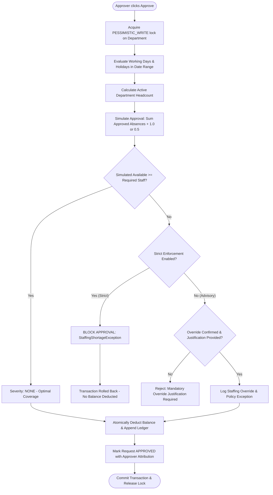
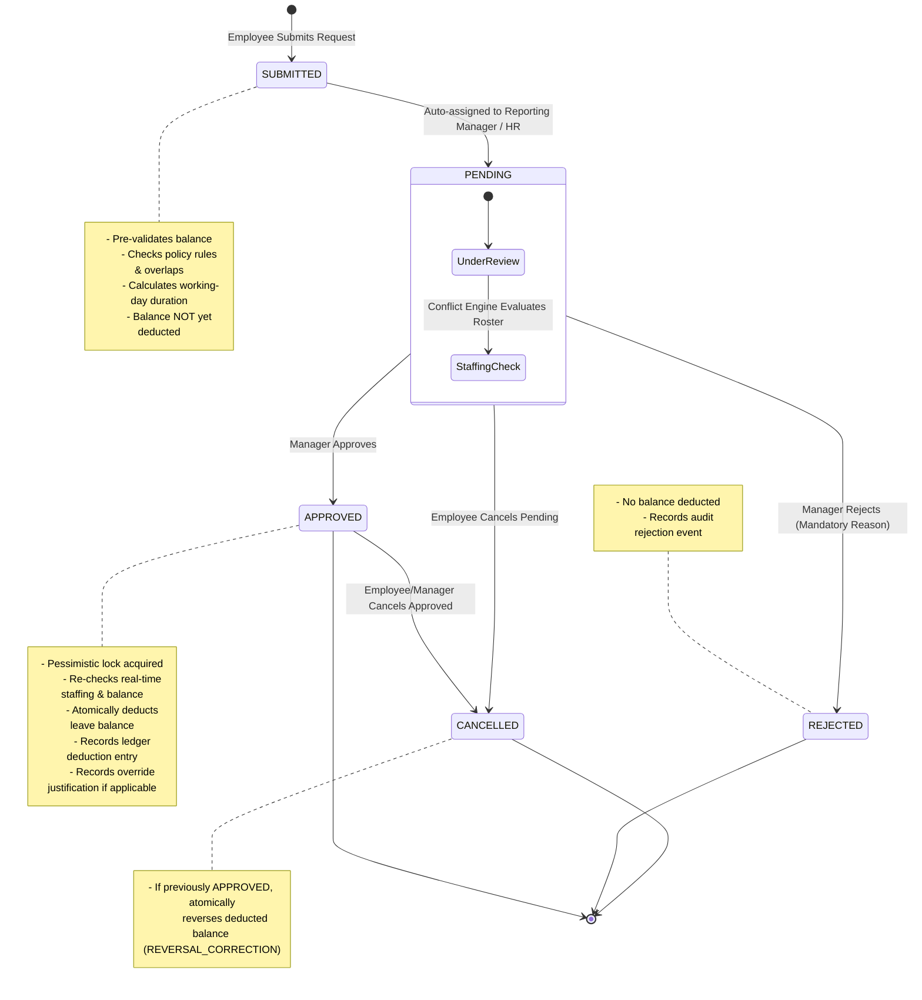

# WorkforcePlan: Employee Leave & Workforce Availability Planning Platform

> **BE CSE Major Project** &bull; An enterprise-grade human capital and operational capacity planning platform engineered with **Java 21**, **Spring Boot 4**, **Spring Security 6**, **Spring Data JPA / Hibernate**, **Thymeleaf**, **Bootstrap 5**, and **MySQL 8**.

---

## Table of Contents
- [1. Overview & Problem Statement](#1-overview--problem-statement)
- [2. System Architecture](#2-system-architecture)
- [3. Core Modules & Functionality](#3-core-modules--functionality)
  - [3.1 Organization & Employee Management](#31-organization--employee-management)
  - [3.2 Leave Configuration & Policy Engine](#32-leave-configuration--policy-engine)
  - [3.3 Working Calendar & Holiday Integration](#33-working-calendar--holiday-integration)
  - [3.4 Entitlements & Double-Entry Balance Ledger](#34-entitlements--double-entry-balance-ledger)
  - [3.5 Leave Request Lifecycle & Approvals](#35-leave-request-lifecycle--approvals)
  - [3.6 Workforce Availability & Conflict Engine](#36-workforce-availability--conflict-engine)
  - [3.7 Staffing Rules & Concurrency Serialization](#37-staffing-rules--concurrency-serialization)
  - [3.8 Workforce Analytics Dashboard](#38-workforce-analytics-dashboard)
  - [3.9 Policy Exception Reporting](#39-policy-exception-reporting)
  - [3.10 System Audit Logging](#310-system-audit-logging)
- [4. Workforce Availability & Conflict Engine Deep Dive](#4-workforce-availability--conflict-engine-deep-dive)
- [5. Authentication, RBAC & Security Architecture](#5-authentication-rbac--security-architecture)
- [6. Leave Request & Approval Workflow](#6-leave-request--approval-workflow)
- [7. Project Structure](#7-project-structure)
- [8. Technology Stack & Dependencies](#8-technology-stack--dependencies)
- [9. Local Setup & Installation Guide](#9-local-setup--installation-guide)
  - [9.1 Prerequisites](#91-prerequisites)
  - [9.2 Database Provisioning](#92-database-provisioning)
  - [9.3 Environment Variables Configuration](#93-environment-variables-configuration)
  - [9.4 Running the Application](#94-running-the-application)
- [10. Running Automated Tests](#10-running-automated-tests)
- [11. Security & Production Considerations](#11-security--production-considerations)
- [12. Implemented vs. Future Capabilities](#12-implemented-vs-future-capabilities)
- [13. Project & Repository Information](#13-project--repository-information)

---

## 1. Overview & Problem Statement

Conventional enterprise leave management systems operate as disconnected administrative record-keepers. They typically track accrued time-off balances in isolation, completely decoupled from operational team staffing constraints. This structural disconnect leads to:

1. **Unplanned Staffing Deficits:** Approving leaves in silos frequently drops active shift coverage below safe operational thresholds.
2. **Approval Race Conditions:** Two managers approving leave requests simultaneously for team members can inadvertently approve competing leaves, triggering sudden departmental understaffing.
3. **Inconsistent Working-Calendar Rules:** Discrepancies between holiday schedules, department-specific workweeks (e.g., standard Monday–Friday vs. continuous 24/7 operations), and leave-duration calculations lead to inaccurate balance deductions.
4. **Lack of Governance on Overrides:** When emergency leave must be granted despite low staffing, conventional platforms lack auditable mechanisms to capture manager justifications and track policy exceptions.

**WorkforcePlan** solves these challenges by embedding an operational **Workforce Availability & Conflict Engine** directly into the leave request and approval lifecycle. Department managers evaluate real-time capacity snapshots, review projected staffing risks, enforce parameterized headcount and percentage thresholds, serialize concurrent approvals with pessimistic database locking, and maintain an immutable financial-grade transaction ledger.

---

## 2. System Architecture

WorkforcePlan adheres to a layered, domain-driven architecture utilizing Spring Boot and Spring MVC:

```mermaid
flowchart TD
    subgraph Presentation_Layer["Presentation Layer (Thymeleaf 3 + Bootstrap 5.3)"]
        UI_Dash["Workforce Dashboard"]
        UI_Req["Leave Requests & Modals"]
        UI_Avail["Availability Calendars"]
        UI_Admin["Policy, Rules & Audit Views"]
    end

    subgraph Security_Layer["Security & Access Control (Spring Security 6)"]
        Sec_Filter["SecurityFilterChain (URL RBAC, CSRF, Form Login)"]
        Sec_Auth["CustomUserDetailsService (BCrypt, Lockout)"]
        Sec_Method["LeaveSecurityService (@PreAuthorize & Route Ownership)"]
    end

    subgraph Service_Layer["Business Logic & Domain Services"]
        Svc_Req["LeaveRequestService"]
        Svc_Bal["LeaveBalanceService (Ledger)"]
        Svc_Avail["WorkforceAvailabilityService"]
        Svc_Conflict["LeaveConflictEngineService"]
        Svc_Calendar["WorkingCalendarService"]
        Svc_Audit["AuditService & ActorResolver"]
        Svc_Excep["PolicyExceptionService"]
    end

    subgraph Persistence_Layer["Data Persistence (Spring Data JPA / Hibernate)"]
        Repo_Emp["Employee & Department Repositories"]
        Repo_Req["LeaveRequestRepository (Pessimistic Locks)"]
        Repo_Bal["LeaveBalance & Transaction Repositories"]
        Repo_Rule["DepartmentStaffingRuleRepository"]
        Repo_Audit["AuditEventRepository"]
    end

    subgraph Database["Relational Store (MySQL 8.0)"]
        DB[(employee_leave_db)]
    end

    Presentation_Layer --> Security_Layer
    Security_Layer --> Service_Layer
    Service_Layer --> Persistence_Layer
    Persistence_Layer --> Database
```



---

## 3. Core Modules & Functionality

### 3.1 Organization & Employee Management
- **Department Hierarchy:** Organization modeling supporting unique codes, active/inactive states, and custom operational calendar settings.
- **Employee Directory:** Tracks full employment lifecycle (`FULL_TIME`, `PART_TIME`, `CONTRACT`, `INTERN`), email uniqueness, date of joining, and reporting hierarchies.
- **Self-Reporting Guards:** Validations prevent circular reporting relationships and disallow employees from being configured as their own manager.

### 3.2 Leave Configuration & Policy Engine
- **Configurable Leave Types:** Categorized with custom identification codes, paid/unpaid flags, medical attachment requirements, and maximum consecutive day limits.
- **Hierarchical Policy Resolution:** Policies specify annual quotas, carry-forward limits, and minimum service days. A deterministic specificity scoring algorithm matches the most specific policy:
  $$\text{Score} = (\text{Department Match} \times 2) + (\text{Employment Type Match} \times 1)$$
  Conflicting policies of identical specificity trigger an explicit `PolicyConflictException` rather than making non-deterministic guesses.

### 3.3 Working Calendar & Holiday Integration
- **Centralized Working Day Resolver:** [`WorkingCalendarService`](src/main/java/com/anudip/employee_leave/service/WorkingCalendarService.java) centralizes all calendar math.
- **Department Weekend Flexibility:** Standard corporate departments observe Monday–Friday workweeks. Continuous/operational departments can enable `includeWeekends = true` via their staffing rule.
- **Holiday Exclusions:** Official company holidays defined in the holiday calendar are unconditionally excluded from leave duration deductions and staffing requirements across all departments.

### 3.4 Entitlements & Double-Entry Balance Ledger
- **Idempotent Allocations:** Annual entitlement initialization uses unique compound keys (`GRANT-EMP_{id}-LT_{id}-YR_{year}`) to prevent duplicate quotas upon repeated execution.
- **Carry-Forward Engine:** Computes unused prior-year balances capped at policy-defined limits (`CF-EMP_{id}-LT_{id}-YR_{year}`).
- **Administrative Adjustments:** Allows HR administrators to manually credit or debit balances with mandatory audit reasons.
- **Immutable Transaction Ledger:** Every balance modification records previous balance, amount changed, resulting balance, transaction type, reference identifier, idempotency key, actor, and timestamp.

### 3.5 Leave Request Lifecycle & Approvals
- **Server-Side Duration Computation:** Calculated strictly against the applicant's department working calendar and published company holidays.
- **Pre-Validation Safeguards:** Pre-checks available balance sufficiency, maximum consecutive day limits, minimum service days, identical-date requirements for half-day requests, and year-boundary constraints.
- **Overlap Prevention:** Rejects submissions overlapping existing `PENDING` or `APPROVED` requests for the same employee.
- **Deferred Balance Deduction:** Balances are **not** debited at submission time. Deductions occur atomically at approval.
- **Cancellation Reversal:** Cancelling an approved leave automatically executes an atomic balance reversal (`REVERSAL_CORRECTION`) restoring the employee's balance.

### 3.6 Workforce Availability & Conflict Engine
- **Daily Availability Snapshots:** Computes eligible active department headcount on any calendar date, taking employee joining dates into account.
- **Absence Weighting:** Full-day absences deduct 1.0 staff; half-day requests contribute 0.5 capacity weight (modeled as estimated daily capacity).
- **Anti-Double-Counting Guard:** When evaluating proposed leaves, the applicant's existing or pending leaves are excluded to prevent artificial deficit inflation.

### 3.7 Staffing Rules & Concurrency Serialization
- **Threshold Rules:** Departments configure absolute minimum required headcount and optional minimum staff percentages.
- **Pessimistic Concurrency Locking:** Department approval transactions obtain an explicit `PESSIMISTIC_WRITE` lock on the department record under `READ_COMMITTED` transaction isolation, serializing competing approvals and eliminating race conditions.
- **Dual Enforcement Modes:**
  - *Strict Enforcement:* System strictly blocks approval if available staff falls below requirement.
  - *Advisory Override:* Approver is alerted to the deficit and may proceed only by confirming an explicit override checkbox and submitting a mandatory written justification.

### 3.8 Workforce Analytics Dashboard
- **Operational Metrics:** Aggregates active employees, departments currently experiencing staffing shortages, employees on leave today, and pending action queues.
- **14-Day Overlapping Horizon:** Queries approved leaves whose date spans overlap the forward 14-day window $[T, T + 14]$, preventing blind spots for ongoing leaves that began prior to today.

### 3.9 Policy Exception Reporting
- **Centralized Governance:** Dedicated tracking of operational exceptions categorized by:
  1. `AUTHORIZED_OVERRIDE`: Approvals granted despite advisory staffing shortages.
  2. `PENDING_SHORTAGE_RISK`: Pending leave applications that would trigger staffing deficits if approved.
  3. `ADMINISTRATIVE_ADJUSTMENT`: Manual balance credits/debits applied by HR.
- **Auditable Details:** Displays direct links to requests, justification notes, impacted departments, and severity levels.

### 3.10 System Audit Logging
- **Transactional Audit Trail:** Immutably records domain events within the business transaction (`Propagation.REQUIRED`), guaranteeing that audit events roll back if the business operation fails.
- **Authenticated Attribution:** Resolves the active Spring Security principal (`AUTH: User [ROLE]`) and safely flags unauthenticated testing/bootstrap operations with `DEV_UNAUTHENTICATED:`.

---

## 4. Workforce Availability & Conflict Engine Deep Dive

The conflict engine evaluates operational capacity before approvals are finalized.

### Staffing Headcount Formula
The minimum required staffing headcount for any active department size is computed as:
$$\text{RequiredStaff} = \max\left(\text{minimumStaffCount},\; \left\lceil \text{activeStaffCount} \times \frac{\text{minimumStaffPercentage}}{100} \right\rceil\right)$$

If no custom staffing rule is configured for an active department, the platform applies a safe default of requiring at least 1 active staff member.



---

## 5. Authentication, RBAC & Security Architecture

WorkforcePlan implements a role-based access control (RBAC) model managed by Spring Security 6.

### Role Hierarchy & Permissions

| Resource / Route | Permitted Roles | Description |
| :--- | :--- | :--- |
| `/login`, `/activate`, `/access-denied`, `/css/**`, `/js/**` | `PermitAll` (Anonymous) | Public assets, authentication, and single-use account activation |
| `/`, `/dashboard`, `/availability/**`, `/leave-requests`, `/leave-balances` | `ROLE_EMPLOYEE`, `ROLE_MANAGER`, `ROLE_HR_ADMIN` | Authenticated self-service, rosters, and general directories |
| `/leave-requests/{id}` (View / Cancel) | Owner, Direct Manager, `ROLE_HR_ADMIN` | Scoped by employee ownership and direct-reporting hierarchy |
| `/leave-requests/pending`, `/leave-requests/*/approve`, `/policy-exceptions/**` | `ROLE_MANAGER`, `ROLE_HR_ADMIN` | Approval queue restricted to manager's direct reports or HR |
| `/employees/new`, `/employees/*/edit`, `/leave-types/**`, `/leave-policies/**`, `/holidays/**`, `/staffing-rules/*/edit`, `/leave-balances/adjust`, `/audit-history/**` | `ROLE_HR_ADMIN` | High-privilege organizational, policy, balance, and audit administration |

### Account Provisioning & Activation
1. **Bootstrap Administrator:** On initial startup, if zero HR Administrator accounts exist, [`AdminAccountInitializer`](src/main/java/com/anudip/employee_leave/security/AdminAccountInitializer.java) provisions a bootstrap administrator using credentials configured via environment variables (`APP_ADMIN_USERNAME` and `APP_ADMIN_PASSWORD`). If no password is provided, automatic provisioning is safely skipped.
2. **Employee Accounts:** Adding an employee creates a corresponding `UserAccount` in a `DISABLED` state (`enabled = false`) with a 64-character cryptographically secure token (`SecureRandom` + Base64 URL encoding) expiring in 48 hours.
3. **Account Activation:** The employee accesses `/activate`, provides their activation token, and sets their password (enforcing a minimum of 8 characters). Upon activation, BCrypt hashing is applied, the token is permanently invalidated, and the account is enabled.
4. **Brute-Force Account Lockout:** [`LoginAttemptListener`](src/main/java/com/anudip/employee_leave/security/LoginAttemptListener.java) listens for authentication failure events. After 5 consecutive failed attempts, the account is temporarily locked for 15 minutes (`lockedUntil = now + 15m`).
5. **Separation of Duties:** Managers cannot approve or reject their own leave requests. Even if a manager accesses an approval endpoint with their own request ID, [`LeaveSecurityService`](src/main/java/com/anudip/employee_leave/security/LeaveSecurityService.java) rejects the action.

---

## 6. Leave Request & Approval Workflow



---

## 7. Project Structure

```
employee-leave/
├── .mvn/wrapper/                   # Maven wrapper runtime binaries & properties
├── src/
│   ├── main/
│   │   ├── java/com/anudip/employee_leave/
│   │   │   ├── EmployeeLeaveApplication.java       # Spring Boot main entrypoint
│   │   │   ├── controller/                         # Spring MVC web controllers
│   │   │   │   ├── AuditHistoryController.java     # Audit trail inspection & filters
│   │   │   │   ├── AuthController.java             # Login, account activation, access denied
│   │   │   │   ├── AvailabilityController.java     # Department availability calendar & daily rosters
│   │   │   │   ├── DepartmentController.java       # Department management
│   │   │   │   ├── EmployeeController.java         # Employee profiles & status toggles
│   │   │   │   ├── HolidayController.java          # Company holiday calendar
│   │   │   │   ├── HomeController.java             # Homepage & workforce analytics dashboard
│   │   │   │   ├── LeaveBalanceController.java     # Balance entitlements & ledger history
│   │   │   │   ├── LeavePolicyController.java      # Annual leave policy configuration
│   │   │   │   ├── LeaveRequestController.java     # Application submission & approval workflow
│   │   │   │   ├── LeaveTypeController.java        # Leave type catalog
│   │   │   │   ├── PolicyExceptionController.java  # Staffing override & exception reporting
│   │   │   │   └── StaffingRuleController.java     # Department threshold configuration
│   │   │   ├── dto/                                # Data transfer objects & report models
│   │   │   │   ├── DailyAvailabilitySnapshot.java  # Headcount & shortage breakdown for a single date
│   │   │   │   ├── DashboardSummaryDTO.java        # Aggregated workforce metrics
│   │   │   │   ├── DepartmentStaffingRuleDTO.java  # Rule definition form model
│   │   │   │   ├── EmployeeAbsenceDetail.java      # Absence weight & employee details
│   │   │   │   ├── LeaveApprovalDTO.java           # Approval/rejection action payload
│   │   │   │   ├── LeaveRequestDTO.java            # Leave application submission payload
│   │   │   │   ├── PolicyExceptionItem.java        # Unified policy exception view item
│   │   │   │   └── WorkforceConflictReport.java    # Multi-day conflict evaluation report
│   │   │   ├── entity/                             # JPA / Hibernate domain entities
│   │   │   │   ├── AuditEvent.java                 # Immutable system audit trail entry
│   │   │   │   ├── ConflictSeverity.java           # NONE, WARNING_PENDING_RISK, CRITICAL_STAFFING_SHORTAGE
│   │   │   │   ├── Department.java                 # Department master record
│   │   │   │   ├── DepartmentStaffingRule.java     # Minimum staff count, percentage & strict mode
│   │   │   │   ├── Employee.java                   # Employee master record with manager hierarchy
│   │   │   │   ├── Holiday.java                    # Company holiday definition
│   │   │   │   ├── LeaveBalance.java               # Annual employee leave balance accumulator
│   │   │   │   ├── LeavePolicy.java                # Leave quota & carry-forward rules
│   │   │   │   ├── LeaveRequest.java               # Leave request record with state transitions
│   │   │   │   ├── LeaveTransaction.java           # Double-entry audit ledger record
│   │   │   │   ├── LeaveType.java                  # Leave type catalog definition
│   │   │   │   ├── Role.java                       # ROLE_EMPLOYEE, ROLE_MANAGER, ROLE_HR_ADMIN
│   │   │   │   └── UserAccount.java                # Security credentials, lockout & activation token
│   │   │   ├── exception/                          # Domain exceptions & error definitions
│   │   │   ├── repository/                         # Spring Data JPA repositories with custom queries
│   │   │   ├── security/                           # Spring Security implementation
│   │   │   │   ├── AccountProvisioningService.java # Disabled provisioning & token activation
│   │   │   │   ├── AdminAccountInitializer.java    # Environment-based bootstrap admin runner
│   │   │   │   ├── CustomUserDetails.java          # Spring Security UserDetails adapter
│   │   │   │   ├── CustomUserDetailsService.java   # Username loading & active status enforcement
│   │   │   │   ├── LeaveSecurityService.java       # Route ownership & self-approval prevention
│   │   │   │   ├── LoginAttemptListener.java       # Authentication event listener for lockout
│   │   │   │   └── SecurityConfig.java             # SecurityFilterChain & PasswordEncoder bean
│   │   │   └── service/                            # Core business logic services
│   │   │       ├── AuditActorResolver.java         # Resolves authenticated vs. dev audit actors
│   │   │       ├── AuditService.java               # Transactional audit logging
│   │   │       ├── DepartmentStaffingRuleService.java # Rule persistence & retrieval
│   │   │       ├── LeaveBalanceService.java        # Quota initialization & ledger deductions
│   │   │       ├── LeaveConflictEngineService.java # Staffing simulation & conflict detection
│   │   │       ├── LeaveRequestService.java        # Request processing & serialized approvals
│   │   │       ├── PolicyExceptionService.java     # Exception aggregation & counts
│   │   │       ├── WorkforceAvailabilityService.java # Daily department availability calculation
│   │   │       ├── WorkforceDashboardService.java  # Metric aggregation for home screen
│   │   │       └── WorkingCalendarService.java     # Working day, weekend & holiday resolution
│   │   └── resources/
│   │       ├── application.properties              # Environment-backed configuration
│   │       ├── application.properties.example      # Portable template configuration
│   │       └── templates/                          # Thymeleaf HTML5 templates
│   │           ├── fragments/navbar.html           # Role-aware navigation header
│   │           ├── index.html                      # Real-time workforce dashboard
│   │           ├── login.html                      # Sign-in page
│   │           ├── activate.html                   # Single-use account activation page
│   │           ├── access-denied.html              # Custom 403 Forbidden page
│   │           ├── audit-history/list.html         # Audit trail filter & table view
│   │           ├── availability/                   # Calendar & department roster views
│   │           ├── departments/list.html           # Department listing
│   │           ├── employees/                      # Employee directory & profile forms
│   │           ├── holidays/                       # Holiday calendar administration
│   │           ├── leave-balances/                 # Balances, adjustments & transaction ledger
│   │           ├── leave-policies/                 # Leave policy administration
│   │           ├── leave-requests/                 # Application form, directory & approval view
│   │           ├── policy-exceptions/list.html     # Exception tracking & severity badges
│   │           └── staffing-rules/                 # Department rule configuration
│   └── test/java/com/anudip/employee_leave/        # 217 unit and integration tests across 35 classes
├── pom.xml                                         # Maven build configuration & dependencies
└── README.md                                       # Comprehensive project documentation
```

---

## 8. Technology Stack & Dependencies

- **Language & Runtime:** Java 21 (LTS)
- **Framework:** Spring Boot 4.0.8
- **Security:** Spring Security 6 & Thymeleaf Extras SpringSecurity6
- **Database & Persistence:** MySQL 8.0, Spring Data JPA, Hibernate 7 (ORM Core)
- **Connection Pool:** HikariCP
- **View Engine:** Thymeleaf 3, Bootstrap 5.3.3, Bootstrap Icons 1.11.3
- **Validation:** Hibernate Validator (Jakarta Bean Validation 3)
- **Build System:** Apache Maven 3.9+ (bundled via Maven Wrapper `mvnw`)
- **Testing Frameworks:** JUnit 5 (Jupiter), AssertJ, Mockito, Spring Test / MockMvc

---

## 9. Local Setup & Installation Guide

### 9.1 Prerequisites
1. **Java Development Kit (JDK):** Version 21 or higher (e.g., Eclipse Adoptium Temurin 21 LTS).
2. **Database Engine:** MySQL Server 8.0 running locally or in Docker.
3. **Build Tool:** Git and Maven (or use the included `mvnw` wrapper).

### 9.2 Database Provisioning
Log in to your local MySQL instance using the MySQL Command Line Client or your preferred database administration tool, and create the application database:

```sql
CREATE DATABASE employee_leave_db CHARACTER SET utf8mb4 COLLATE utf8mb4_unicode_ci;
```

> **Note:** The platform uses `spring.jpa.hibernate.ddl-auto=update`. Tables, foreign key constraints, indexes, and unique keys will be automatically created on the first application startup.

### 9.3 Environment Variables Configuration
WorkforcePlan is configured using portable environment variables with sensible defaults. Configure the following variables in your terminal before launching the application:

| Variable Name | Default Value | Description |
| :--- | :--- | :--- |
| `SPRING_DATASOURCE_URL` | `jdbc:mysql://127.0.0.1:3306/employee_leave_db` | JDBC connection URL to MySQL |
| `SPRING_DATASOURCE_USERNAME` | `root` | Database username |
| `SPRING_DATASOURCE_PASSWORD` | *(empty)* | Database user password |
| `APP_ADMIN_USERNAME` | `admin` | Bootstrap administrator username |
| `APP_ADMIN_PASSWORD` | *(empty)* | Password for bootstrap administrator on initial startup |

#### Example Configuration File
A ready-to-use template is available at [`src/main/resources/application.properties.example`](src/main/resources/application.properties.example). You may copy it to `src/main/resources/application.properties` and customize values for local development.

### 9.4 Running the Application

#### On Windows (PowerShell)
```powershell
# 1. Set environment variables
$env:JAVA_HOME = "C:\Program Files\Eclipse Adoptium\jdk-21.0.12.101-hotspot"
$env:Path = "$env:JAVA_HOME\bin;$env:Path"
$env:SPRING_DATASOURCE_PASSWORD = "YourDatabasePassword"
$env:APP_ADMIN_PASSWORD = "YourSecureAdminPassword123!"

# 2. Run with Maven Wrapper
cd C:\Users\kanoj\Projects\anudip_employee\employee-leave
.\mvnw.cmd spring-boot:run
```

#### On Linux / macOS (Bash)
```bash
# 1. Export environment variables
export JAVA_HOME="/usr/lib/jvm/temurin-21"
export PATH="$JAVA_HOME/bin:$PATH"
export SPRING_DATASOURCE_PASSWORD="YourDatabasePassword"
export APP_ADMIN_PASSWORD="YourSecureAdminPassword123!"

# 2. Run with Maven Wrapper
cd employee-leave
./mvnw spring-boot:run
```

Once started, navigate to `http://localhost:8080` in your web browser.

---

## 10. Running Automated Tests

The test suite contains **217 automated tests across 35 test classes**, covering domain logic unit tests, MockMvc controller slice tests, security authorization tests, and database-backed concurrency integration tests.

### Run the Full Test Suite
Ensure your MySQL service is running and execute:

```powershell
# Windows
$env:SPRING_DATASOURCE_PASSWORD = "YourDatabasePassword"
.\mvnw.cmd test

# Linux / macOS
SPRING_DATASOURCE_PASSWORD="YourDatabasePassword" ./mvnw test
```

### Run Targeted Test Suites
```powershell
# Run Authentication & RBAC integration tests
.\mvnw.cmd test "-Dtest=AuthenticationRbacIntegrationTest"

# Run Staffing Conflict & Concurrency integration tests
.\mvnw.cmd test "-Dtest=WorkforceAvailabilityConflictIntegrationTest"

# Run Leave Request Workflow integration tests
.\mvnw.cmd test "-Dtest=LeaveRequestWorkflowIntegrationTest"

# Run all Controller tests
.\mvnw.cmd test "-Dtest=*ControllerTest"
```

---

## 11. Security & Production Considerations

- **Zero Hardcoded Secrets:** No database passwords, administrator credentials, or secret keys are hardcoded in the codebase. All credentials rely on runtime environment variables.
- **CSRF Protection:** CSRF token verification is active across all HTTP POST state modifications via Thymeleaf form helpers.
- **Cryptographic Hashing:** Passwords are never stored in plaintext; all credentials use BCrypt hashing.
- **Activation Token Security:** Employee onboarding tokens are 64 characters in length, cryptographically random, expire in 48 hours, and are invalidated immediately upon first use.
- **Defensive Auditing:** All domain mutations capture the authenticated principal. Database transactions enforce ACID guarantees across balance ledger updates and audit trail entries.
- **Git Hygiene:** Local configuration overrides (`.env`, `application-local.properties`), log files, and database dump files (`*.sql`, `*.dump`) are explicitly excluded via `.gitignore`.

---

## 12. Implemented vs. Future Capabilities

### Currently Implemented (Phases 1–9)
- [x] Full employee, department, and hierarchical manager profile directory.
- [x] Paid/unpaid leave types with consecutive day caps and attachment flags.
- [x] Multi-tier annual policy specificity resolution engine (`PolicyConflictException` guard).
- [x] Centralized working calendar excluding official holidays and respecting department weekend rules.
- [x] Double-entry leave balance ledger with idempotent annual grants, carry-forwards, and manual adjustments.
- [x] Leave request lifecycle: multi-day/half-day submissions, deferred deductions, and cancellation reversals.
- [x] Real-time workforce availability snapshots and absence weighting (half-days labeled as estimated daily capacity).
- [x] Department staffing rules: headcount and percentage thresholds, strict blocking vs. advisory override.
- [x] Pessimistic database concurrency locking (`PESSIMISTIC_WRITE`) serializing simultaneous leave approvals.
- [x] Comprehensive workforce dashboard with live metrics, 14-day overlapping leave horizon, and pending action queues.
- [x] Dedicated policy exception view logging authorized overrides, pending shortage risks, and manual adjustments.
- [x] System-wide immutable audit trail with authenticated user attribution.
- [x] Spring Security 6 authentication, single-use activation tokens, brute-force lockout, role-based URL/method authorization.

### Future Architectural Enhancements
- [ ] **Shift-Level Scheduling:** Extending daily availability capacity to multi-shift intraday schedules (e.g., Morning, Evening, Night shift rotations).
- [ ] **Email & Slack Notifications:** Automated notification dispatch upon leave submission, manager approval, or shortage escalation.
- [ ] **File Attachment Storage:** Integration with AWS S3 or Google Cloud Storage for medical certificates and supporting leave documentation.
- [ ] **Multi-Tenant Support:** Database partitioning for multi-organization enterprise deployments.

---

## 13. Project & Repository Information

- **Project:** Employee Leave & Workforce Availability Planning Platform
- **Academic Context:** BE CSE Major Project
- **GitHub Repository:** [Curio-2021/employee-leave-workforce-planning](https://github.com/Curio-2021/employee-leave-workforce-planning)
- **Primary Branch:** `main`
- **Release Version:** `0.0.1-SNAPSHOT` (Complete Phases 1–9)
