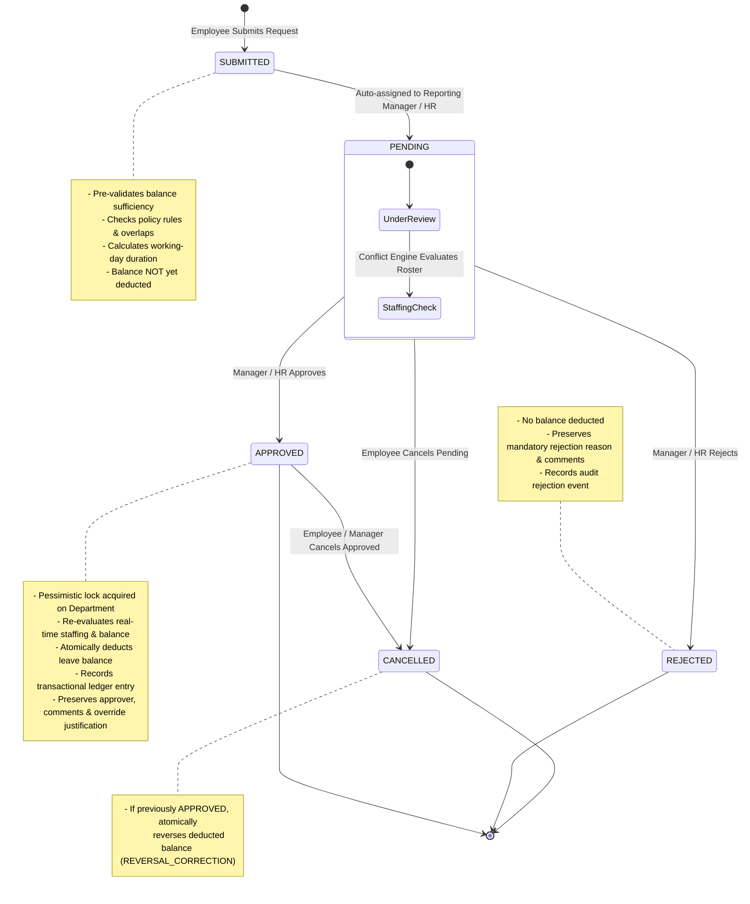

# WorkforcePlan: Employee Leave & Workforce Availability Planning Platform

> A production-structured human capital and operational capacity planning platform engineered with **Java 21**, **Spring Boot 4.0.8**, **Spring Security 7.0.7** (via `spring-boot-starter-security` and `thymeleaf-extras-springsecurity6`), **Spring Data JPA / Hibernate 7**, **Thymeleaf 3**, **Bootstrap 5.3**, and **MySQL 8.0**.

---

## Table of Contents
- [1. Overview & Problem Statement](#1-overview--problem-statement)
- [2. System Architecture](#2-system-architecture)
- [3. Functional Modules (Professor's Specification)](#3-functional-modules-professors-specification)
  - [3.1 Employee Management](#31-employee-management)
  - [3.2 Leave Policy Management](#32-leave-policy-management)
  - [3.3 Leave Type Management](#33-leave-type-management)
  - [3.4 Leave Balance Management](#34-leave-balance-management)
  - [3.5 Leave Request Management](#35-leave-request-management)
  - [3.6 Approval Management](#36-approval-management)
  - [3.7 Team Availability Management](#37-team-availability-management)
  - [3.8 Conflict Detection Engine](#38-conflict-detection-engine)
  - [3.9 Holiday Calendar Management](#39-holiday-calendar-management)
  - [3.10 Leave Adjustment Management](#310-leave-adjustment-management)
  - [3.11 Workforce Dashboard](#311-workforce-dashboard)
  - [3.12 Audit History](#312-audit-history)
- [4. Core Business Engine: Workforce Availability & Conflict Engine](#4-core-business-engine-workforce-availability--conflict-engine)
- [5. Authentication, RBAC & Security Architecture](#5-authentication-rbac--security-architecture)
- [6. Leave Request & Approval Lifecycle](#6-leave-request--approval-lifecycle)
- [7. Project Structure](#7-project-structure)
- [8. Technology Stack & Dependencies](#8-technology-stack--dependencies)
- [9. Local Setup & Installation Guide](#9-local-setup--installation-guide)
  - [9.1 Prerequisites](#91-prerequisites)
  - [9.2 Database Provisioning](#92-database-provisioning)
  - [9.3 Environment Variables Configuration](#93-environment-variables-configuration)
  - [9.4 Running the Application](#94-running-the-application)
- [10. Running Automated Tests](#10-running-automated-tests)
- [11. Security & Production Considerations](#11-security--production-considerations)
- [12. Implementation Status & Roadmap](#12-implementation-status--roadmap)
- [13. Project & Repository Information](#13-project--repository-information)

---

## 1. Overview & Problem Statement

Conventional organizational leave management systems operate primarily as passive administrative record-keepers. They typically track accrued time-off balances in isolation, completely decoupled from operational team staffing constraints. This structural disconnect leads to critical real-world operational challenges:

1. **Unplanned Staffing Deficits:** Approving leaves in departmental silos frequently drops active shift coverage below safe operational thresholds.
2. **Approval Race Conditions:** Two managers approving leave requests simultaneously for team members can inadvertently approve competing leaves, triggering sudden departmental understaffing.
3. **Inconsistent Working-Calendar Rules:** Discrepancies between holiday schedules, department-specific workweeks (e.g., standard Monday–Friday vs. continuous operations), and leave-duration calculations lead to inaccurate balance deductions.
4. **Lack of Governance on Overrides:** When emergency leave must be granted despite low staffing, conventional platforms lack auditable mechanisms to capture manager justifications and track policy exceptions.

**WorkforcePlan** solves these challenges by embedding an operational **Workforce Availability & Conflict Engine** directly into the leave request and approval lifecycle. Department managers evaluate real-time capacity snapshots, review projected staffing risks, enforce parameterized headcount and percentage thresholds, serialize concurrent approvals with pessimistic database locking, and maintain an immutable transactional leave-balance ledger.

---

## 2. System Architecture

WorkforcePlan adheres to a layered, domain-driven architecture utilizing Spring Boot and Spring MVC:

```mermaid
flowchart TD
    subgraph Presentation_Layer["Presentation Layer (Thymeleaf 3 + Bootstrap 5.3)"]
        UI_Dash["Workforce Dashboard"]
        UI_Req["Leave Requests & Approval Modals"]
        UI_Avail["Availability Calendars & Roster"]
        UI_Admin["Policy, Rules, Adjustments & Audit Views"]
    end

    subgraph Security_Layer["Security & Access Control (Spring Security 7 / RBAC)"]
        Sec_Filter["SecurityFilterChain (URL RBAC, CSRF, Form Login)"]
        Sec_Auth["CustomUserDetailsService (BCrypt, Lockout Guard)"]
        Sec_Method["LeaveSecurityService (@PreAuthorize & Route Ownership)"]
    end

    subgraph Service_Layer["Business Logic & Domain Services"]
        Svc_Req["LeaveRequestService"]
        Svc_Bal["LeaveBalanceService (Transactional Ledger)"]
        Svc_Avail["WorkforceAvailabilityService"]
        Svc_Conflict["LeaveConflictEngineService"]
        Svc_Calendar["WorkingCalendarService"]
        Svc_Audit["AuditService & ActorResolver"]
        Svc_Excep["PolicyExceptionService"]
    end

    subgraph Persistence_Layer["Data Persistence (Spring Data JPA / Hibernate 7)"]
        Repo_Emp["Employee & Department Repositories"]
        Repo_Req["LeaveRequestRepository (Pessimistic Locks)"]
        Repo_Bal["LeaveBalance & Transaction Repositories"]
        Repo_Rule["DepartmentStaffingRuleRepository"]
        Repo_Audit["AuditEventRepository"]
    end

    subgraph Database["Relational Store (MySQL 8.0)"]
        DB[(employee_leave_db)]
    end

    Presentation_Layer --> Security_Layer
    Security_Layer --> Service_Layer
    Service_Layer --> Persistence_Layer
    Persistence_Layer --> Database
```



---

## 3. Functional Modules (Professor's Specification)

The application addresses the **12 core functional modules** defined in the course specification (with 11 modules fully implemented and Module 2 partially implemented regarding policy-level approval configuration):

### 3.1 Employee Management
- **Employee Directory:** Tracks complete employee profile records including unique employee ID, full name, unique email, department, designation, joining date, employment type (`FULL_TIME`, `PART_TIME`, `CONTRACT`, `INTERN`), and employment status (`ACTIVE`, `INACTIVE`).
- **Department Association:** Associates employees with organizational departments modeled by [`Department`](src/main/java/com/anudip/employee_leave/entity/Department.java) (unique name, description, and employee roster; operational rules such as weekend inclusion are configured via linked staffing rules).
- **Hierarchical Reporting:** Models reporting manager relationships for workflow approvals.
- **Integrity Guards:** Validates and prevents circular reporting relationships, self-reporting (an employee cannot be their own manager), and cascading deletions of active employees.

### 3.2 Leave Policy Management
- **Configurable Policies:** Configures annual allocations, carry-forward allowance, maximum carry-forward limits, and minimum service day requirements.
- **Hierarchical Policy Resolution:** Policies can be global, scoped to a department, or scoped to an employment type. A deterministic specificity scoring algorithm matches the most specific applicable policy:
  $$\text{Score} = (\text{Department Match} \times 2) + (\text{Employment Type Match} \times 1)$$
  Conflicting policies of identical specificity trigger an explicit `PolicyConflictException` rather than guessing non-deterministically.
- **Approval Routing vs. Configurable Policy Approval Requirements:**
  - *Implemented Approval Workflow:* Approval requirements are universally enforced across all leave requests through an organizational hierarchy workflow in [`LeaveRequestService`](src/main/java/com/anudip/employee_leave/service/LeaveRequestService.java). Submitted requests enter `PENDING` status and are dynamically routed to the employee's active reporting manager (`MANAGER_APPROVAL`) or fallback HR approvers (`HR_APPROVAL`), with self-approval strictly prohibited.
  - *Architectural Distinction:* The `LeavePolicy` entity itself does not currently define independently configurable approval requirements (such as policy-level auto-approval toggles, custom multi-tier approval chains, or policy-specific approver roles). Approval is enforced as a universal organizational workflow rather than a parameterized rule on individual policies.

### 3.3 Leave Type Management
- **Catalog Management:** Supports standard and custom leave types (Casual Leave, Sick Leave, Earned Leave, Special Leave, etc.).
- **Leave Attributes:** Configures unique identification codes, paid/unpaid status flags, medical certificate/attachment requirement flags, and maximum consecutive day restrictions.
- **Active State Toggling:** Supports soft activation/deactivation of leave types without deleting historical leave records.

### 3.4 Leave Balance Management
- **Entitlement Calculation:** Computes annual leave quotas, carried-forward balances, and available balances based on active policies and employment tenure.
- **Idempotent Annual Grants:** Annual entitlement initialization uses unique compound keys (`GRANT-EMP_{id}-LT_{id}-YR_{year}`) to prevent duplicate quotas upon repeated execution.
- **Carry-Forward Processing:** Evaluates unused prior-year balances capped at policy-defined maximum limits (`CF-EMP_{id}-LT_{id}-YR_{year}`).
- **Transactional Leave-Balance Ledger:** Maintains an accumulator entity ([`LeaveBalance`](src/main/java/com/anudip/employee_leave/entity/LeaveBalance.java)) paired with an append-only transactional audit ledger ([`LeaveTransaction`](src/main/java/com/anudip/employee_leave/entity/LeaveTransaction.java)). Every change records previous balance, amount changed, resulting balance, transaction type, idempotency key, actor, and timestamp.

### 3.5 Leave Request Management
- **Request Lifecycle:** Supports multi-day and half-day leave applications with mandatory submission reasons.
- **Working-Calendar Duration Math:** Calculates duration strictly against the applicant's department working calendar and published company holidays via [`WorkingCalendarService`](src/main/java/com/anudip/employee_leave/service/WorkingCalendarService.java).
- **Pre-Validation Checks:** Pre-checks available balance sufficiency, maximum consecutive day limits, minimum service days, identical-date requirements for half-day requests, and year-boundary constraints.
- **Overlap Prevention:** Rejects submissions that overlap existing `PENDING` or `APPROVED` requests for the same employee.
- **Deferred Balance Deduction:** Balances are **not** debited at submission time. Deductions occur atomically at approval time.
- **Cancellation Reversal:** Cancelling an approved leave automatically executes an atomic balance reversal (`REVERSAL_CORRECTION`) restoring the employee's balance.

### 3.6 Approval Management
- **Dynamic Routing:** Routes pending leave requests to designated reporting managers (`MANAGER_APPROVAL`) or fallback HR approvers (`HR_APPROVAL`).
- **Separation of Duties:** Employees are strictly prohibited from approving or rejecting their own leave requests.
- **Preservation of Decisions & Comments:** Approval decisions, approver comments, rejection reasons, and staffing override justifications are permanently preserved in the [`LeaveRequest`](src/main/java/com/anudip/employee_leave/entity/LeaveRequest.java) record (`decidedBy`, `decisionTimestamp`, `approverComments`, `rejectionReason`, `staffingOverrideJustification`) and mirrored in the system audit log.
- **Mandatory Rejection Reasons:** Rejection requires an explicit, non-empty justification reason explaining why the request was turned down.

### 3.7 Team Availability Management
- **Daily Availability Snapshots:** Computes eligible active department headcount for any calendar date, taking employee joining dates and employment status into account.
- **Absence Weighting:** Full-day absences deduct 1.0 staff; half-day requests contribute 0.5 capacity weight (modeled as estimated daily capacity).
- **Anti-Double-Counting Guard:** When evaluating proposed leaves, the applicant's existing or pending leaves are excluded to prevent artificial deficit inflation.
- **Availability Views:** Provides department-wide daily availability calendars and rosters indicating who is available and who is on leave.

### 3.8 Conflict Detection Engine
- **Pre-Approval Capacity Simulation:** Simulates the effect of approving a leave request against existing approved absences, pending requests, and department staffing thresholds.
- **Conflict Severity Classification:**
  - `NONE`: Optimal coverage; department remains comfortably staffed.
  - `WARNING_PENDING_RISK`: Competing pending requests in the same department could cause a future shortage.
  - `CRITICAL_STAFFING_SHORTAGE`: Approval would cause available staffing to drop below configured department minimums.
- **Detailed Impact Breakdown:** Generates a structured multi-day report ([`WorkforceConflictReport`](src/main/java/com/anudip/employee_leave/dto/WorkforceConflictReport.java)) showing date-by-date active headcount, scheduled absences, and shortage margins.

### 3.9 Holiday Calendar Management
- **Organization Holiday Registry:** Configures official company holidays with specific calendar dates, names, and observance years.
- **Exclusion from Leave Durations:** Holidays falling within a requested leave window are automatically excluded from leave-duration deductions (employees are not charged leave for company holidays).
- **Exclusion from Staffing Requirements:** Holidays are recognized as non-working days where minimum staffing constraints do not apply.

### 3.10 Leave Adjustment Management
- **Authorized HR Adjustments:** Authorized HR administrators can manually credit or debit an employee's leave balance with a mandatory justification reason and reference number.
- **Separate Transaction Tracking:** Manual adjustments are recorded distinctly from normal leave deductions:
  - Uses specific transaction types (`MANUAL_ADJUSTMENT_CREDIT` and `MANUAL_ADJUSTMENT_DEBIT`).
  - Generates distinct idempotency keys (`ADJ-{UUID}`) separate from approved leave deductions (`LEAVE-DEDUCTION-{requestNumber}`).
  - Tracks cumulative manual adjustment credits and debits on the `LeaveBalance` entity.

### 3.11 Workforce Dashboard
- **Executive & Operational Metrics:** Aggregates active employee count, departments currently experiencing staffing shortages, employees on leave today, and pending approval queues.
- **14-Day Overlapping Horizon:** Queries approved leaves whose date spans overlap the forward 14-day window $[T, T + 14]$, preventing blind spots for ongoing leaves that began prior to today.
- **Actionable Shortcut Queues:** Displays prioritized pending leave requests requiring manager or HR review.

### 3.12 Audit History
- **Transactional Audit Logging:** Records domain events within the active business transaction (`Propagation.REQUIRED`), guaranteeing that audit events roll back if the business operation fails.
- **Comprehensive Event Coverage:** Captures lifecycle events across employees, departments, staffing rules, policies, balances, manual adjustments, submissions, approvals, overrides, rejections, and cancellations.
- **Authenticated Attribution:** Resolves the active Spring Security principal (`AUTH: User [ROLE]`) and safely flags unauthenticated testing/bootstrap operations with `DEV_UNAUTHENTICATED:`.

---

## 4. Core Business Engine: Workforce Availability & Conflict Engine

The **Workforce Availability & Leave Conflict Engine** serves as the primary operational intelligence layer, integrating Team Availability Management, Conflict Detection, Working Calendars, and Department Staffing Rules.

### Staffing Headcount Formula
The minimum required staffing headcount for any active department is dynamically evaluated as:
$$\text{RequiredStaff} = \max\left(\text{minimumStaffCount},\; \left\lceil \text{activeStaffCount} \times \frac{\text{minimumStaffPercentage}}{100} \right\rceil\right)$$

If no custom staffing rule is configured for an active department, the platform applies a safe default of requiring at least 1 active staff member.


### Pessimistic Concurrency Serialization
To prevent approval race conditions where two managers approve competing leaves simultaneously, the approval workflow acquires a `PESSIMISTIC_WRITE` lock on the department record under `READ_COMMITTED` transaction isolation. Competing approvals are serialized, ensuring each approval evaluates real-time capacity snapshots.

### Dual Enforcement Modes
- **Strict Enforcement:** The system strictly blocks approval if available staff falls below the required threshold (`StaffingShortageException`).
- **Advisory Override:** The approver is warned of the deficit and may proceed only by confirming an explicit override checkbox and submitting a mandatory written justification.

---

## 5. Authentication, RBAC & Security Architecture

WorkforcePlan implements a role-based access control (RBAC) model managed by Spring Security 7.

### Role Hierarchy & Permissions

| Resource / Route | Permitted Roles | Description |
| :--- | :--- | :--- |
| `/login`, `/activate`, `/access-denied`, `/css/**`, `/js/**` | `PermitAll` (Anonymous) | Public assets, authentication, and single-use account activation |
| `/`, `/dashboard`, `/availability/**`, `/leave-requests`, `/leave-balances` | `ROLE_EMPLOYEE`, `ROLE_MANAGER`, `ROLE_HR_ADMIN` | Authenticated self-service, rosters, and general directories |
| `/leave-requests/{id}` (View / Cancel) | Owner, Direct Manager, `ROLE_HR_ADMIN` | Scoped by employee ownership and direct-reporting hierarchy |
| `/leave-requests/pending`, `/leave-requests/*/approve`, `/policy-exceptions/**` | `ROLE_MANAGER`, `ROLE_HR_ADMIN` | Approval queue restricted to manager's direct reports or HR |
| `/employees/new`, `/employees/*/edit`, `/leave-types/**`, `/leave-policies/**`, `/holidays/**`, `/staffing-rules/*/edit`, `/leave-balances/adjust`, `/audit-history/**` | `ROLE_HR_ADMIN` | High-privilege organizational, policy, balance, and audit administration |

### Account Provisioning & Activation
1. **Bootstrap Administrator:** On initial startup, if zero HR Administrator accounts exist, [`AdminAccountInitializer`](src/main/java/com/anudip/employee_leave/security/AdminAccountInitializer.java) provisions a bootstrap administrator using credentials configured via environment variables (`APP_ADMIN_USERNAME` and `APP_ADMIN_PASSWORD`). If no password is provided, automatic provisioning is safely skipped.
2. **Employee Accounts:** Adding an employee creates a corresponding `UserAccount` in a `DISABLED` state (`enabled = false`) with a 64-character cryptographically secure token (`SecureRandom` + Base64 URL encoding) expiring in 48 hours.
3. **Account Activation:** The employee accesses `/activate`, provides their activation token, and sets their password (enforcing a minimum of 8 characters). Upon activation, BCrypt hashing is applied, the token is permanently invalidated, and the account is enabled.
4. **Brute-Force Account Lockout:** [`LoginAttemptListener`](src/main/java/com/anudip/employee_leave/security/LoginAttemptListener.java) listens for authentication failure events. After 5 consecutive failed attempts, the account is temporarily locked for 15 minutes (`lockedUntil = now + 15m`).
5. **Separation of Duties:** Managers cannot approve or reject their own leave requests. Even if a manager accesses an approval endpoint with their own request ID, [`LeaveSecurityService`](src/main/java/com/anudip/employee_leave/security/LeaveSecurityService.java) rejects the action.

---

## 6. Leave Request & Approval Lifecycle



---

## 7. Project Structure

```
employee-leave/
├── .mvn/wrapper/                   # Maven wrapper runtime binaries & properties
├── src/
│   ├── main/
│   │   ├── java/com/anudip/employee_leave/
│   │   │   ├── EmployeeLeaveApplication.java       # Spring Boot main entrypoint
│   │   │   ├── controller/                         # Spring MVC web controllers
│   │   │   │   ├── AuditHistoryController.java     # Audit trail inspection & filters
│   │   │   │   ├── AuthController.java             # Login, account activation, access denied
│   │   │   │   ├── AvailabilityController.java     # Department availability calendar & daily rosters
│   │   │   │   ├── DepartmentController.java       # Department management
│   │   │   │   ├── EmployeeController.java         # Employee profiles & status toggles
│   │   │   │   ├── HolidayController.java          # Company holiday calendar
│   │   │   │   ├── HomeController.java             # Homepage & workforce analytics dashboard
│   │   │   │   ├── LeaveBalanceController.java     # Balance entitlements & ledger history
│   │   │   │   ├── LeavePolicyController.java      # Annual leave policy configuration
│   │   │   │   ├── LeaveRequestController.java     # Application submission & approval workflow
│   │   │   │   ├── LeaveTypeController.java        # Leave type catalog
│   │   │   │   ├── PolicyExceptionController.java  # Staffing override & exception reporting
│   │   │   │   └── StaffingRuleController.java     # Department threshold configuration
│   │   │   ├── dto/                                # Data transfer objects & report models
│   │   │   │   ├── DailyAvailabilitySnapshot.java  # Headcount & shortage breakdown for a single date
│   │   │   │   ├── DashboardSummaryDTO.java        # Aggregated workforce metrics
│   │   │   │   ├── DepartmentStaffingRuleDTO.java  # Rule definition form model
│   │   │   │   ├── EmployeeAbsenceDetail.java      # Absence weight & employee details
│   │   │   │   ├── LeaveApprovalDTO.java           # Approval/rejection action payload
│   │   │   │   ├── LeaveRequestDTO.java            # Leave application submission payload
│   │   │   │   ├── PolicyExceptionItem.java        # Unified policy exception view item
│   │   │   │   └── WorkforceConflictReport.java    # Multi-day conflict evaluation report
│   │   │   ├── entity/                             # JPA / Hibernate domain entities
│   │   │   │   ├── AuditEvent.java                 # Immutable system audit trail entry
│   │   │   │   ├── ConflictSeverity.java           # NONE, WARNING_PENDING_RISK, CRITICAL_STAFFING_SHORTAGE
│   │   │   │   ├── Department.java                 # Department master record
│   │   │   │   ├── DepartmentStaffingRule.java     # Minimum staff count, percentage & strict mode
│   │   │   │   ├── Employee.java                   # Employee master record with manager hierarchy
│   │   │   │   ├── Holiday.java                    # Company holiday definition
│   │   │   │   ├── LeaveBalance.java               # Annual employee leave balance accumulator
│   │   │   │   ├── LeavePolicy.java                # Leave quota & carry-forward rules
│   │   │   │   ├── LeaveRequest.java               # Leave request record with state transitions
│   │   │   │   ├── LeaveTransaction.java           # Transactional audit ledger record
│   │   │   │   ├── LeaveType.java                  # Leave type catalog definition
│   │   │   │   ├── Role.java                       # ROLE_EMPLOYEE, ROLE_MANAGER, ROLE_HR_ADMIN
│   │   │   │   └── UserAccount.java                # Security credentials, lockout & activation token
│   │   │   ├── exception/                          # Domain exceptions & error definitions
│   │   │   ├── repository/                         # Spring Data JPA repositories with custom queries
│   │   │   ├── security/                           # Spring Security implementation
│   │   │   │   ├── AccountProvisioningService.java # Disabled provisioning & token activation
│   │   │   │   ├── AdminAccountInitializer.java    # Environment-based bootstrap admin runner
│   │   │   │   ├── CustomUserDetails.java          # Spring Security UserDetails adapter
│   │   │   │   ├── CustomUserDetailsService.java   # Username loading & active status enforcement
│   │   │   │   ├── LeaveSecurityService.java       # Route ownership & self-approval prevention
│   │   │   │   ├── LoginAttemptListener.java       # Authentication event listener for lockout
│   │   │   │   └── SecurityConfig.java             # SecurityFilterChain & PasswordEncoder bean
│   │   │   └── service/                            # Core business logic services
│   │   │       ├── AuditActorResolver.java         # Resolves authenticated vs. dev audit actors
│   │   │       ├── AuditService.java               # Transactional audit logging
│   │   │       ├── DepartmentStaffingRuleService.java # Rule persistence & retrieval
│   │   │       ├── LeaveBalanceService.java        # Quota initialization & ledger deductions
│   │   │       ├── LeaveConflictEngineService.java # Staffing simulation & conflict detection
│   │   │       ├── LeaveRequestService.java        # Request processing & serialized approvals
│   │   │       ├── PolicyExceptionService.java     # Exception aggregation & counts
│   │   │       ├── WorkforceAvailabilityService.java # Daily department availability calculation
│   │   │       ├── WorkforceDashboardService.java  # Metric aggregation for home screen
│   │   │       └── WorkingCalendarService.java     # Working day, weekend & holiday resolution
│   │   └── resources/
│   │       ├── application.properties              # Environment-backed configuration
│   │       ├── application.properties.example      # Portable template configuration
│   │       └── templates/                          # Thymeleaf HTML5 templates
│   │           ├── fragments/navbar.html           # Role-aware navigation header
│   │           ├── index.html                      # Real-time workforce dashboard
│   │           ├── login.html                      # Sign-in page
│   │           ├── activate.html                   # Single-use account activation page
│   │           ├── access-denied.html              # Custom 403 Forbidden page
│   │           ├── audit-history/list.html         # Audit trail filter & table view
│   │           ├── availability/                   # Calendar & department roster views
│   │           ├── departments/list.html           # Department listing
│   │           ├── employees/                      # Employee directory & profile forms
│   │           ├── holidays/                       # Holiday calendar administration
│   │           ├── leave-balances/                 # Balances, adjustments & transaction ledger
│   │           ├── leave-policies/                 # Leave policy administration
│   │           ├── leave-requests/                 # Application form, directory & approval view
│   │           ├── policy-exceptions/list.html     # Exception tracking & severity badges
│   │           └── staffing-rules/                 # Department rule configuration
│   └── test/java/com/anudip/employee_leave/        # 217 unit and integration tests across 35 classes
├── pom.xml                                         # Maven build configuration & dependencies
└── README.md                                       # Comprehensive project documentation
```

---

## 8. Technology Stack & Dependencies

- **Language & Runtime:** Java 21 (Eclipse Adoptium Temurin 21 LTS)
- **Framework Parent:** Spring Boot 4.0.8 (`spring-boot-starter-parent`)
- **Security:** Spring Security 7.0.7 (resolved via `spring-boot-starter-security` 4.0.8) & `thymeleaf-extras-springsecurity6` (3.1.3.RELEASE)
- **Database & Persistence:** MySQL 8.0, Spring Data JPA, Hibernate 7 (ORM Core)
- **Connection Pool:** HikariCP
- **View Engine:** Thymeleaf 3, Bootstrap 5.3.3, Bootstrap Icons 1.11.3
- **Validation:** Hibernate Validator (Jakarta Bean Validation 3)
- **Build System:** Apache Maven 3.9+ (bundled via Maven Wrapper `mvnw`)
- **Testing Frameworks:** JUnit 5 (Jupiter), AssertJ, Mockito, Spring Test / MockMvc

---

## 9. Local Setup & Installation Guide

### 9.1 Prerequisites
1. **Java Development Kit (JDK):** Version 21 or higher (e.g., Eclipse Adoptium Temurin 21 LTS).
2. **Database Engine:** MySQL Server 8.0 running locally or in Docker.
3. **Build Tool:** Git and Maven (or use the included `mvnw` wrapper).

### 9.2 Database Provisioning
Log in to your local MySQL instance using the MySQL Command Line Client or your preferred database administration tool, and create the application database:

```sql
CREATE DATABASE employee_leave_db CHARACTER SET utf8mb4 COLLATE utf8mb4_unicode_ci;
```

> **Note:** The platform uses `spring.jpa.hibernate.ddl-auto=update`. Tables, foreign key constraints, indexes, and unique keys will be automatically created on the first application startup.

### 9.3 Environment Variables Configuration
WorkforcePlan is configured using portable environment variables with sensible defaults. Configure the following variables in your terminal before launching the application:

| Variable Name | Default Value | Description |
| :--- | :--- | :--- |
| `SPRING_DATASOURCE_URL` | `jdbc:mysql://127.0.0.1:3306/employee_leave_db` | JDBC connection URL to MySQL |
| `SPRING_DATASOURCE_USERNAME` | `root` | Database username |
| `SPRING_DATASOURCE_PASSWORD` | *(empty)* | Database user password |
| `APP_ADMIN_USERNAME` | `admin` | Bootstrap administrator username |
| `APP_ADMIN_PASSWORD` | *(empty)* | Password for bootstrap administrator on initial startup |

#### Example Configuration File
A ready-to-use template is available at [`src/main/resources/application.properties.example`](src/main/resources/application.properties.example). You may copy it to `src/main/resources/application.properties` and customize values for local development.

### 9.4 Running the Application

#### On Windows (PowerShell)
```powershell
# 1. Set environment variables
$env:JAVA_HOME = "C:\Program Files\Eclipse Adoptium\jdk-21.0.12.101-hotspot"
$env:Path = "$env:JAVA_HOME\bin;$env:Path"
$env:SPRING_DATASOURCE_PASSWORD = "YourDatabasePassword"
$env:APP_ADMIN_PASSWORD = "YourSecureAdminPassword123!"

# 2. Run with Maven Wrapper
cd C:\Users\kanoj\Projects\anudip_employee\employee-leave
.\mvnw.cmd spring-boot:run
```

#### On Linux / macOS (Bash)
```bash
# 1. Export environment variables
export JAVA_HOME="/usr/lib/jvm/temurin-21"
export PATH="$JAVA_HOME/bin:$PATH"
export SPRING_DATASOURCE_PASSWORD="YourDatabasePassword"
export APP_ADMIN_PASSWORD="YourSecureAdminPassword123!"

# 2. Run with Maven Wrapper
cd employee-leave
./mvnw spring-boot:run
```

Once started, navigate to `http://localhost:8080` in your web browser.

---

## 10. Running Automated Tests

The test suite contains **217 automated tests across 35 test classes**, covering domain logic unit tests, MockMvc controller slice tests, security authorization tests, and database-backed concurrency integration tests.

### Run the Full Test Suite
Ensure your MySQL service is running and execute:

```powershell
# Windows
$env:SPRING_DATASOURCE_PASSWORD = "YourDatabasePassword"
.\mvnw.cmd test

# Linux / macOS
SPRING_DATASOURCE_PASSWORD="YourDatabasePassword" ./mvnw test
```

### Run Targeted Test Suites
```powershell
# Run Authentication & RBAC integration tests
.\mvnw.cmd test "-Dtest=AuthenticationRbacIntegrationTest"

# Run Staffing Conflict & Concurrency integration tests
.\mvnw.cmd test "-Dtest=WorkforceAvailabilityConflictIntegrationTest"

# Run Leave Request Workflow integration tests
.\mvnw.cmd test "-Dtest=LeaveRequestWorkflowIntegrationTest"

# Run all Controller tests
.\mvnw.cmd test "-Dtest=*ControllerTest"
```

---

## 11. Security & Production Considerations

- **Zero Hardcoded Secrets:** No database passwords, administrator credentials, or secret keys are hardcoded in the codebase. All credentials rely on runtime environment variables.
- **CSRF Protection:** CSRF token verification is active across all HTTP POST state modifications via Thymeleaf form helpers.
- **Cryptographic Hashing:** Passwords are never stored in plaintext; all credentials use BCrypt hashing.
- **Activation Token Security:** Employee onboarding tokens are 64 characters in length, cryptographically random, expire in 48 hours, and are invalidated immediately upon first use.
- **Defensive Auditing:** All domain mutations capture the authenticated principal. Database transactions enforce ACID guarantees across balance ledger updates and audit trail entries.
- **Git Hygiene:** Local configuration overrides (`.env`, `application-local.properties`), log files, and database dump files (`*.sql`, `*.dump`) are explicitly excluded via `.gitignore`.

---

## 12. Implementation Status & Roadmap

### Implemented Capabilities (Phases 1–8 Implemented & Automated Verification Passing)
- [x] **Module 1 (Employee Management):** Full employee directory, department associations, and hierarchical manager reporting with self-reporting guards.
- [ ] **Module 2 (Leave Policy Management) &mdash; Partially Implemented:** Annual entitlements, carry-forward rules, minimum service days, department/employment-type policy scope, and specificity resolution engine (`PolicyConflictException` guard) are fully implemented. Independently configurable policy-level approval requirements (such as policy-specific approval toggles or custom approval chains) remain future work, while universal approval routing is handled across all requests via the implemented manager/HR approval workflow.
- [x] **Module 3 (Leave Type Management):** Paid/unpaid leave types with consecutive day caps and medical attachment requirement flags.
- [x] **Module 4 (Leave Balance Management):** Transactional leave-balance ledger with idempotent annual grants, carry-forwards, and resulting balance tracking.
- [x] **Module 5 (Leave Request Management):** Multi-day/half-day submissions, working-calendar duration math, overlap detection, and deferred balance deductions.
- [x] **Module 6 (Approval Management):** Hierarchical routing (`MANAGER_APPROVAL` / `HR_APPROVAL`), self-approval prevention, preservation of decisions, comments, and mandatory rejection reasons.
- [x] **Module 7 (Team Availability Management):** Real-time daily availability snapshots and absence weighting (half-days labeled as estimated daily capacity).
- [x] **Module 8 (Conflict Detection Engine):** Pre-approval capacity simulation, shortage severity levels (`NONE`, `WARNING_PENDING_RISK`, `CRITICAL_STAFFING_SHORTAGE`).
- [x] **Module 9 (Holiday Calendar Management):** Centralized holiday calendar unconditionally excluded from leave deductions and staffing requirements.
- [x] **Module 10 (Leave Adjustment Management):** Dedicated manual balance credits/debits tracked separately (`MANUAL_ADJUSTMENT_*` with `ADJ-*` keys) from leave deductions.
- [x] **Module 11 (Workforce Dashboard):** Live operational metrics, 14-day forward overlapping leave horizon, and pending action queues.
- [x] **Module 12 (Audit History):** Immutable audit trail recording actor, action, entity type, entity ID, department ID, timestamp, and details across all entity lifecycles.
- [x] **Core Business Engine:** Concurrency serialization via pessimistic database locking (`PESSIMISTIC_WRITE` on `Department`) and dual enforcement modes (Strict vs Advisory Override).
- [x] **Security & Access Control (Phase 8):** Spring Security 7 RBAC, URL and method-level security, single-use activation tokens, and brute-force lockout.

### Phase 9 Release Verification & Ongoing Work
- **Automated Test Suite:** 217 tests across 35 test classes pass against live MySQL 8 (0 failures, 0 errors, 0 skipped).
- **Outstanding Release Tasks:** Manual end-to-end interactive browser testing across user roles, production containerization/packaging, and final academic sign-off.

### Future Architectural Enhancements
- [ ] **Configurable Policy-Specific Approval Rules:** Supporting per-policy approval rules (e.g., policy-level auto-approval thresholds, multi-tier manager approval chains, or custom approver roles defined directly on `LeavePolicy`).
- [ ] **Shift-Level Scheduling:** Extending daily availability capacity to multi-shift intraday schedules (e.g., Morning, Evening, Night shift rotations).
- [ ] **Email & Slack Notifications:** Automated notification dispatch upon leave submission, manager approval, or shortage escalation.
- [ ] **File Attachment Storage:** Integration with AWS S3 or Google Cloud Storage for medical certificates and supporting leave documentation.
- [ ] **Multi-Tenant Support:** Database partitioning for multi-organization enterprise deployments.

---

## 13. Project & Repository Information

- **Project:** Employee Leave & Workforce Availability Planning Platform
- **Academic Context:** BE CSE Major Project
- **GitHub Repository:** [Curio-2021/employee-leave-workforce-planning](https://github.com/Curio-2021/employee-leave-workforce-planning)
- **Primary Branch:** `main`
- **Release Version:** `0.0.1-SNAPSHOT` (Phases 1–8 Implemented & Verified; Phase 9 Automated Verification Passing)
